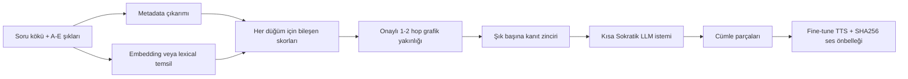

# AYT Tarih kaynak bağlı koçluk çekirdeği

`apps/api/app/ayt_knowledge_graph.py` üç sınırı tek bir modülde tutar:

1. **Veri modeli:** `NodeType`, `RelationType`, `NodeMetadata`, `HistoricalNode`,
   `Edge`, `KnowledgeGraph`, `QuestionItem` ve `TutorDialogueState` Pydantic
   modelleridir. Onaylanmamış düğüm veya kenar arama sonucuna giremez.
2. **Ağırlıklı arama:** Her soru kökü ve şık ayrı sorgulanır. Skor bileşenleri
   `0,45 × kosinüs/lexical + 0,25 × kesin metadata + 0,10 × node_weight +
   0,20 × onaylı graf yakınlığı` olarak ayrı alanlarda döner. Tarih, kişi, yer,
   antlaşma ve kavram etiketleri yalnız aday genişletme değil, puanlanmış
   metadata sinyalidir; alıntı ve kaynak kimliği olmadan kanıt oluşmaz.
3. **Orkestrasyon:** `SocraticTutorOrchestrator` önce arama yapar, sonra yalnız
   kaynak kimliklerini içeren kısa bağlamla yerel LLM'i çağırır, erken cevap
   ifşasını engeller ve cümleleri içerik adresli WAV önbelleğine yollar.

## Ağırlıklı arama akışı

Örnek şema yükü [ayt-knowledge-graph-example.json](ayt-knowledge-graph-example.json)
dosyasındadır. Bu örnek cevap anahtarı içermez. Cevap anahtarı yalnız private
değerlendirme katmanında, ayrı bir dosyada tutulmalıdır.
