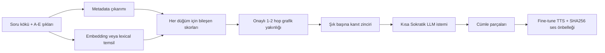

# AYT Tarih kaynak bağlı koçluk çekirdeği

`apps/api/app/ayt_knowledge_graph.py` üç sınırı tek bir modülde tutar:

1. **Veri modeli:** `NodeType`, `RelationType`, `NodeMetadata`, `HistoricalNode`,
   `Edge`, `KnowledgeGraph`, `QuestionItem` ve `TutorDialogueState` Pydantic
   modelleridir. Onaylanmamış düğüm veya kenar arama sonucuna giremez.
2. **Ağırlıklı arama:** Her soru kökü ve şık ayrı sorgulanır. Skor bileşenleri
   `0,45 × kosinüs/lexical + 0,25 × kesin metadata + 0,10 × node_weight +
   0,20 × onaylı graf yakınlığı` olarak ayrı alanlarda döner. Tarih, kişi, yer,
   antlaşma ve kavram etiketleri yalnız aday genişletme değil, puanlanmış
   metadata sinyalidir; alıntı ve kaynak kimliği olmadan kanıt oluşmaz.
3. **Orkestrasyon:** `SocraticTutorOrchestrator` önce arama yapar, sonra yalnız
   onaylı düğüm açıklamaları, onaylı kenar alıntıları ve kaynak kimliklerinden
   oluşan kısa bağlamla yerel LLM'i çağırır, erken cevap ifşasını engeller ve
   cümleleri içerik adresli WAV önbelleğine yollar. İstem uzunluğu Qwen servis
   sınırına göre kesilir; model veya TTS servisi yoksa deterministik geri dönüş
   kullanılır.

`KnowledgeGraphBuilder.add_corpus(...)` MEB corpus’unun kitap–bölüm–parça
hiyerarşisini checksum’a bağlı aday düğümlere dönüştürür. `pre_review` ve
`quality_checked` kapısı geçilmeden hiçbir parça veya hiyerarşi kenarı onaylı
arama kümesine alınmaz. Kişi, olay ve antlaşma düğümleri ayrıca öğretmen
onaylı atomlar olarak eklenir; otomatik çıkarım kendiliğinden öğrenciye kanıt
olmaz.

## Ağırlıklı arama akışı

Örnek şema yükü [ayt-knowledge-graph-example.json](ayt-knowledge-graph-example.json)
dosyasındadır. Bu örnek cevap anahtarı içermez. Cevap anahtarı yalnız private
değerlendirme katmanında, ayrı bir dosyada tutulmalıdır.

## Runtime ve onay kapısı

`ayt_tutor_routes.py` içindeki `/v1/ayt-tutor/turn` yalnızca
`AYT_APPROVED_GRAPH_PATH` ile gösterilen, öğretmen onayından geçirilmiş grafi
yüklenebildiğinde çalışır. Aday corpus ve agent incelemeleri bu kapıyı açamaz.
`promote_ayt_graph_approvals.py` checksum, PDF alıntısı, sayfa/bbox ve insan
reviewer kimliğini doğrular; onay şablonu `build_ayt_graph_approval_template.py`
ile üretilir.

Private retrieval karşılaştırmaları `RetrievalGold` ve `evaluate_retrieval`
ile aynı sonuç sözleşmesinden ölçülür: Recall@1/@3, MRR@3, nDCG@3, yanlış
kanıt oranı ve çekimser kalma doğruluğu. Gold etiketler runtime nesnesine veya
yerel LLM istemine taşınmaz.

Her tutor turu ayrıca `retrieval`, `first_token`, `llm`, `tts` ve `total`
milisaniye alanlarını üretir. İlk ses hedefi bu ölçümle izlenir; herhangi bir
optimizasyon ölçülmüş gecikme ve koçluk kalitesi birlikte değerlendirilmeden
varsayılan yapılmaz.
