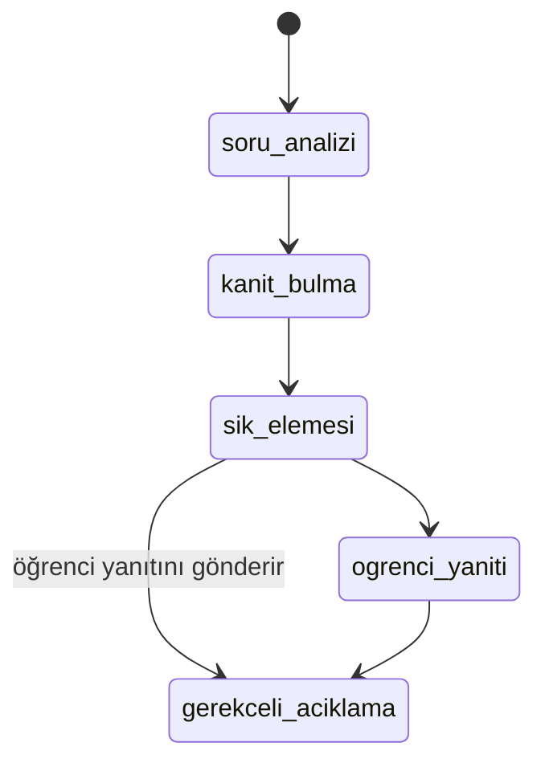

# Tarih soru koçu v1

Koç yalnız öğretmence onaylı soru ve MEB kaynak parçalarıyla çalışır. Oturum
sunucuda şu sırayı izler:



`answer_label` öğrenci API'sine ve LLM istemine girmez. Sunucu onu yalnız
`gerekceli_aciklama` aşamasında, kaynak doğrulaması varsa kullanır. LLM metni
şık veya cevap ifşası içerirse atılır ve deterministik kaynak bağlı ipucu
döner. Kaynak yoksa sistem tahmin etmez.

## Retrieval

V1 etkin yol, konu filtresi içindeki öğretmence onaylı parçalarla BM25'tir.
`app/pipeline/history_rag_dense_compare.py`, önceden üretilmiş BGE-M3 vektörleri
ile dense ve RRF adaylarını değerlendirir. Bu aday, kapalı geliştirme setinde
Recall@k, MRR ve yanlış kanıt oranını BM25'e karşı iyileştirmeden etkin yola
alınmayacaktır. Bu nedenle şu anki ürün yanıtı `BM25` taban çizgisini dürüstçe
korur.

## Öğretmen incelemesi ve QLoRA

Öğretmen önce `/v1/question-bank/teacher/tutor/questions/{id}/review` ile
onaylı kaynak kimliklerini görür. Her soru için ilk üç aşamayı inceler; kayıt
zorunlu olarak kaynak kimlikleri, erken cevap ifşası, kaynak bağlılık, sade
Türkçe ve inceleyen kişiyi içerir. QLoRA dışa aktarım kapısı 60 tamamlanmış
soru grubu ve 180 onaylı örnektir.

```bash
cd apps/api
.venv/bin/python -m app.pipeline.export_tutor_qlora \
  --module-id SOURCE_CHECKSUM_ILK_16 \
  --kaggle-output ../../data/private/kaggle/history-tutor-qlora-input-v1 \
  --sealed-output ../../data/private/history-tutor-sealed-v1
```

Kaggle dizininde yalnız `train.jsonl`, `dev.jsonl` ve manifest bulunur. Kapalı
test ayrı yerel dizinde kalır. Dışa aktarılan satırlar soru metni, MEB alıntısı,
sayfa/koordinat, cevap anahtarı veya öğrenci verisi taşımaz; yalnız koçluk
protokolü ve öğretmen onaylı davranış yanıtıdır.

`experiments/kaggle/history_tutor_qwen14b_qlora.py`, Qwen3-14B'nin sabit
revision'ı için NF4 4-bit, fp16, gradient checkpointing, LoRA ve
completion-only loss kullanır. Eğitimden sonra taban model ile adaptör aynı
kapalı testte kaynak bağlılık, aşama uyumu, erken ifşa ve Türkçe sadelikte
karşılaştırılmadan adaptör etkinleştirilmez.

## Yerel çalıştırma ve gecikme

`tutor-llm` GPU profili ayrı süreçtir. API yalnız yapılandırılmış kısa istemi
gönderir; servis PDF, soru bankası ve cevap anahtarı bağlamaz. Ayrıntılar
[yerel model rehberinde](local-tutor-llm.md). Koç yanıtında retrieval, ilk
token, LLM toplamı ve istek toplamı milisaniye olarak bulunur. İlk kısa cümle
`short_spoken_text` alanında ayrıdır; TTS hemen bu alanla başlatılabilir.
