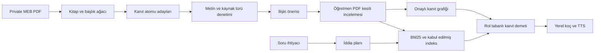

# Kaynak bağlı tarih bilgi grafiği

Not dosyasındaki ağaç, ağırlık, düğüm uzaklığı, Rust, token düzeyinde arama ve
NotebookLM fikirlerinin mevcut AYT pilotuna göre değerlendirilmiş uygulama
sırası [AYT kaynak arama ve grafik deney planında](ayt-kaynak-arama-grafi-deney-plani.md)
bulunur. Bu plan, aşağıdaki mevcut ürün kapılarını otomatik olarak değiştirmez.

Bu belge, öğretmen/yönetici panelindeki **Mimari Haritası** ekranının teknik
eşidir. Ham MEB metni, ÖSYM/deneme soruları, cevap anahtarı ve öğrenci verisi
burada ya da Git'te yer almaz.



Erişilebilir metinsel karşılığı: başlık ağacı kaynağın kitap içindeki yerini,
kanıt atomu kısa ve kaynaklanabilir ders bilgisini, grafik kaynakla doğrulanmış
ilişkileri, indeks ise yalnız aday sıralamasını temsil eder. Bunlar aynı veri
nesnesi değildir ve birinin puanı diğerinin kanıtı sayılmaz.

## Sürüm ve güvenlik modeli

- Her kaynak parçası PDF checksum’ı, sayfa, koordinat ve kaynak sürümüne
  bağlıdır. Kaynak veya çıkarım politikası değişirse eski onay, kanıt demeti,
  grafik ve embedding yapıtı etkin kabul edilmez.
- `history-knowledge-architecture-v1` manifesti yalnız sayım, durum, sürüm,
  kalite uyarısı ve metrik özeti taşır. Metin, alıntı, soru, şık, cevap anahtarı
  veya öğrenci verisi alanları reddedilir.
- `history-knowledge-pilot-snapshot-v1`, private çoklu kitap corpus’undan
  üretilir. 10–12. sınıf AYT pilotunun kitap ağacını panelde görünür kılar;
  hiçbir chunk metnini taşımadığı için panelin API yanıtı güvenle özetlenebilir.
- Alias ve anahtar kelime yalnız keşif/getirme içindir. Öğrenciye açılan her
  grafik ilişkisi, birebir alıntı taşıyan onaylı kaynak kenarına bağlıdır.

## Zaman ve grafik

Tarih/dönem düğümü isteğe bağlı normalleştirilmiş `start_year`, `end_year`,
`precision` ve `era` taşır. Bunlar zaman çizelgesinde sıralama içindir.
Belirsiz dönem kesin yıl gibi kaydedilmez. Kişi, olay, yer ve kavram düğümüne
zaman aralığı eklenemez.

Grafik önerisi otomatik üretilebilir; yayın kararını yalnız PDF kesitiyle insan
incelemesi verir. Böylece otomatik çıkarıcı kapsama açığını göstermeye yarar,
fakat kaynaksız tarih bilgisi üretmez.

## Retrieval kabulü

Etkin taban çizgisi öğretmen onaylı kaynaklar üzerinde BM25’tir. Dense, RRF ve
reranker yalnız aynı geliştirme kümesinde BM25’e göre Recall@3 `+0,05`, MRR@3
`+0,03` artış; yanlış kanıt oranında artış olmaması ve p95 `≤1 saniye`
koşullarını sağlarsa etkinleşir. Panel kabul durumunu ve ölçülen özeti gösterir.

Üç boyutlu veya Gaussian-splatting benzeri görünüm metin retrieval kararında
kullanılmaz. Erişilebilir çekirdek; klavyeyle gezilebilen ağaç, zaman
çizelgesi, tablo ve kartlardan oluşur. Üç boyutlu görünüm eklenirse yalnız
öğretmen keşfi için ikincil bir projeksiyon olur.

## Private AYT pilot özeti üretme

Private corpus hazır olduğunda yalnız aşağıdaki content-free özet üretilir:

```bash
PYTHONPATH=apps/api apps/api/.venv/bin/python -m app.pipeline.build_history_architecture_snapshot \
  --corpus data/private/yks-ayt-source-v1/multi-history-rag-v2.json \
  --output data/private/yks-ayt-source-v1/history-architecture-snapshot-v1.json
```

API sürecinde `HISTORY_ARCHITECTURE_SNAPSHOT` bu private dosyayı göstermelidir.
İsteğe bağlı kabul edilmiş hibrit retrieval yapıtı için
`HISTORY_RAG_HYBRID_ARTIFACT` kullanılır. Her iki dosya da Git ve öğrenci
istemcisi dışında kalır.

## Pilot deneyler ve dış ikinci görüş

Grafik ön doldurma, yalnız kaynakta iki uçlu ilişkiyi birebir bulduğunda
**öneri** üretir. `HISTORY_GRAPH_PREFILL_REPORT` ile yüklenen rapor; soru ve
iddia sayısını, birebir kapsama oranını ve onaysız öneri sayısını gösterir.
Sıfır öneri, yetersiz kanıt bulunduğunu gösteren güvenli bir sonuçtur; sistem
bu durumda ilişki uydurmaz.

İzinli, private bir harici model deneyi yapılacaksa
`HISTORY_EXTERNAL_EVIDENCE_EVALUATION` yalnız içeriği saklamayan deney özetini
yükler: karar sayıları, süre yüzdeleri, model etiketi ve erişim sınırları.
Deney; yalnız iddia ile kısa kaynak kesitini PDF kırpım inceleme sırasına
yardımcı olmak için değerlendirebilir. Cevap anahtarı ve öğrenci verisi
gönderilmez; model kararı hiçbir zaman kaynak onayı, grafik kenarı, retrieval,
QLoRA satırı veya öğrenci yanıtı olmaz. Bu deney öğrenci çalışma anında kapalıdır.

Kaynak-içi ilişki pilotu için `HISTORY_SOURCE_RELATION_PROPOSALS` kullanılır.
Bu pilot yalnız seçilmiş MEB kesitinden çıkarılan, iki ucu ve kısa kaynak fiili
yerelde doğrulanmış **önerileri** sayar. Soru metni veya cevap anahtarı dış
inceleyiciye gitmez. İlişki, ilgili PDF kırpımı insan tarafından doğrulanmadan
grafiğe, RAG'a veya QLoRA verisine aktarılamaz.
