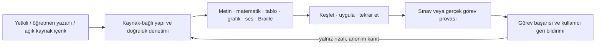

# ErişSTEM ürün vizyonu ve araştırma programı

Araştırma tarihi: 9 Ekim 2026. Bu belge ürün yönünü tanımlar; gerçek kullanıcı görüşmesi veya öğrenme etkisi sonucu içermez. Odak, Türkiye'de Türkçe konuşan görme yetersizliği olan kişilerdir. Türkçe kalite korunmadan çok dilli genişleme iddiası yapılmaz.

## Ürün tanımı

ErişSTEM bir PDF seslendirme aracı, yalnız MEB kitabı dönüştürücüsü veya LLM sohbet ekranı değildir. Amaç, kişinin kendi araçlarıyla içeriği bulabilmesi, anlayabilmesi, soru çözebilmesi, yanıt girebilmesi ve sınav ya da gerçek görev bağlamında ilerleyebilmesidir.

Başarı ölçütü “bir şeyi seslendirdik” değildir. Kullanıcı bağımsız biçimde öğrenme işini tamamlıyor mu sorusudur.

## Hedef kitle: seviye değil, öğrenme görevi

İlkokul, ortaokul, lise, üniversite, mesleki gelişim ve yetişkin öğrenmesi birbirini dışlamaz. Bunlar zorunlu kategori değildir. İçerik, isteğe bağlı öğrenme amacı, ön koşul, alan, zorluk, sınav bağlamı ve temsil gereksinimi etiketleri taşır. Kişi tıbbi tanı, görme geçmişi veya okul seviyesi vermek zorunda kalmadan başlayabilir.

| Kullanıcının işi | Sistemden beklenen sonuç |
| --- | --- |
| İçeriği bulmak ve okumak | Başlık, bölüm, soru, seçenek, kaynak ve kaldığı yer arasında güvenilir gezinme |
| STEM yapısını anlamak | Notasyonun sesli/Braille erişimi; tablo, grafik ve şeklin katmanlı açıklaması |
| Soru çözmek | Soru, seçenek ve yanıt biçimini ayırma; yardımı bağımsız denemeyle karıştırmama |
| Çalışmayı sürdürmek | Hedef, tekrar, not alma ve silinebilir ilerleme |
| Sınava hazırlanmak | Kendi onaylı düzenlemesine göre süre, geri dönüş ve yanıt değiştirme provası |
| Üretmek | Klavye/Braille girişine açık yanıt, not ve erişilebilir çıktı |

Braille ekranı, NVDA, JAWS, VoiceOver, TalkBack, büyütme, klavye, sesli okuyucu, dokunsal materyal ve insan desteği bağlama göre birleşebilen araçlardır. Kullanıcıyı tek bir görme profiline otomatik yerleştirmek ürün hatası olur.

Türkiye'de görme engelli bireylerin cebir öğrenmesi üzerine çalışma, bireyselleştirilmiş destek, yardımcı araç, notasyon/grafik, duyuşsal etkenler ve sınav sorunlarının birlikte ele alınması gerektiğini buldu. Bu, tek bir yaş grubuna genelleme değildir; fakat yalnız sesli metnin yetersiz olduğuna güçlü bir işarettir. [Aktaş ve Argün, 2021](https://dergipark.org.tr/tr/pub/ozelegitimdergisi/article/750682)

## İlk ürün sorununu seçme yöntemi

“En çok fayda” geliştiricinin sezgisiyle seçilmeyecek. Gerçek kullanıcı oturumlarından sonra aday problemler aşağıdaki puan kartıyla karşılaştırılacak:

| Ölçüt | Sorulacak soru |
| --- | --- |
| Sıklık | Engel hangi öğrenme bağlamlarında ne kadar sık çıkıyor? |
| Bağımsızlık etkisi | Çözüm dış yardımı azaltıyor mu? |
| Ciddiyet | Hata öğrenmeyi, sınavı veya mahremiyeti ne kadar etkiliyor? |
| Teknik çözülebilirlik | Kaynak, temsil ve doğruluk ölçülebilir mi? |
| İçerik hakkı | İçerik yetkili, açık veya öğretmen tarafından yayımlanabilir mi? |
| Doğrulama maliyeti | Uzman ve kullanıcı testiyle güvenli yayın mümkün mü? |

Başlangıç adayları Türkçe STEM notasyonu ve soru çözme; üniversite ders materyalinde yapı/gezinti; sınav erişim provası; erken okuryazarlık; gündelik ve mesleki bilgi becerileridir. Hiçbiri henüz birinci hedef ilan edilmedi. Mevcut 9. sınıf kümeler, çember ve uçak modülleri yalnız ölçülebilir görev döngüsünü sınayan sentetik araştırma dilimleridir.

MEB kaynakları değerli bir içerik kanalıdır; ürünün kimliği değildir. MEB, üniversite ders notu, açık eğitim kaynağı, yetkili yayınevi veya öğretmen yazarlı içerik aynı yayın sözleşmesini izler. Kaynak hakkı, sürümü ve insan onayı olmadan hiçbir kanal öğrenci içeriğine dönüşmez.

## Mühendislik mimarisi

Her öğrenme nesnesi kaynak/izin, öğrenme amacı, ön koşullar, yapısal içerik, temsil seçenekleri, doğrulama kanıtı ve görevlerle sürümlenir. Sınıf düzeyi zorunlu alan değildir. Ham OCR veya model çıktısı öğrenciye doğrudan gitmez.

| İçerik türü | Asgari erişilebilir temsil | Yayın engeli |
| --- | --- | --- |
| Düz metin | Başlık hiyerarşisi, dil etiketi, gezinme birimi | Kaynak/sürüm doğrulanmamışsa |
| Matematik | Yapısal MathML, Türkçe okuma planı, mümkünse matematik Braille | Operatör veya ilişki belirsizse |
| Tablo | Hücre-başlık ilişkisi, satır/sütun gezintisi | Başlık eşlemesi belirsizse |
| Grafik/şekil | Kısa amaç, ayrıntılı yapı/veri ve dokunsal yönerge | Kritik eksen, ölçek veya ilişki belirsizse |
| Ses | Metne ve sürüme bağlı WAV, kalite kanıtı | Söz, kalite veya dinleyici kanıtı yoksa |
| Alıştırma | Öğretim, ipucu ve değerlendirme sözleşmeleri ayrı | Puanlama belirsizse veya cevap sızıyorsa |

MathML ses, Braille ve yapısal gezinme için ortak gösterimdir. MathCAT, NVDA ve JAWS ile konuşma, Braille ve ifade içinde gezinme sağlayabilir. Platform farklılıkları nedeniyle Türkçe okunuş ve Braille gerçek araçlarda ayrıca doğrulanacaktır. [MathCAT](https://daisy.github.io/MathCAT/users.html) ve [DAISY MathML ilkeleri](https://daisy.org/activities/standards/daisy/mathml/).

## Yapay zekânın doğru yeri

| Bileşen | Uygun kullanım | Kesin sınır |
| --- | --- | --- |
| OCR, VLM, CNN | Sayfa türü, okuma sırası, tablo/grafik/formül adayı | Kaynak karşılaştırması ve insan onayı olmadan yayın yok |
| LLM | Kaynak-bağlı açıklama/ipuçları için öğretmen adayı üretimi | Cevap anahtarı veya sınav hakkı tahmin etmemek |
| Yerel TTS | Türkçe okuma planını seslendirme, kalite/fine-tune deneyi | Metin-sürüm bağlama, dinleyici testi, ses/izin kaydı |
| Öğrenme analitiği | Rızalı araştırmada görev başarısı ve erişim yardımı | Otomatik tanı veya puan vermemek |

Model sayısı değil, kullanıcının hangi işi daha bağımsız yaptığı başarı kanıtıdır. LLM yalnız doğrulanabilir girdisi, çıktı şeması, kaynak bağı ve insan denetimi olan dar işlerde kullanılır.

## Katılımcı araştırma programı

İlk 6–8 yetişkin keşif oturumu nüfusu temsil etme iddiası taşımaz; engelleri ve varsayımları açığa çıkarır. Sonra alan uzmanlarıyla içerik/temsil incelemesi yapılır. Çocuklar, okul verisi veya öğrenme etkisi araştırması için kurum/etik ve veli-öğrenci rızası ayrı süreçtir. Gerçek ad, ses, sağlık belgesi, not ve ham yanıt Git'e ya da genel uygulama günlüğüne girmez.

Kişi kendi cihazı ve alışık olduğu yardımcı teknolojiyle içerik bulma, tekrar dinleme, formül/tablo gezintisi, yanıt girişi, soruya dönüş, ses hızı ve sınav zamanlaması görevlerini dener. Kanıtlar; erişim, temsil, anlama, gecikmeli öğrenme, güven ve yük olarak ayrı raporlanır.

MEB yönetmeliği materyal, yöntem ve sınav uyarlamasının öğrencinin eğitim performansı/ihtiyacına göre ele alındığını gösterir. Uygulama bu nedenle sabit bir görme profili veya otomatik sınav hakkı tanımlamaz. [MEB Özel Eğitim Hizmetleri Yönetmeliği](https://orgm.meb.gov.tr/alt_sayfalar/mevzuat/Ozel_Egitim_Hizmetleri_Yonetmeligi_son.pdf)

## Aşamalı teslim planı

| Aşama | Çıktı | Geçiş koşulu |
| --- | --- | --- |
| 0 — Keşif | Kullanıcı yolculukları, problem puan kartı, rızalı görev bulguları | Birincil sorun gerçek oturumlardan seçildi |
| 1 — Güvenilir çekirdek | Kaynak bağı, çoklu temsil, ayrı inceleme/yayın, silinebilir ilerleme | Kritik içerik/odak/yanıt hatası yok |
| 2 — İlk değerli iş | Seçilen görev için uçtan uca öğrenme ve prova akışı | Kullanıcılar kendi araçlarında bağımsız tamamlıyor |
| 3 — Model iyileştirmesi | OCR/VLM/TTS/fine-tune karşılaştırması ve model kartı | Aynı görevde ölçülen yarar ve güvenlik kanıtı |
| 4 — Kurum pilotu | Yetkili içerik, OIDC, denetim kaydı, operasyon kılavuzu | Kurum erişilebilirlik ve içerik sahipliği incelemesi |
| 5 — Dil/ülke genişlemesi | Dil paketi, yerel sınav kuralı, yerel uzman/doğrulama | Türkçe kaliteyi varsaymadan ayrı doğrulama |

WCAG 2.2 otomatik tarama ile tamamlanmaz. Klavye odağı, görünür odak, hedef boyutu, durum mesajları ve erişilebilir kimlik doğrulama NVDA, JAWS, VoiceOver ve TalkBack ile gerçek görev testine ek olarak denetlenir. [W3C WCAG 2.2](https://www.w3.org/WAI/standards-guidelines/wcag/new-in-22/)

## Bitirme projesinin doğru iddiası

“Bütün görme engelli öğrenciler için bütün dersleri çözdük” demeyeceğiz. Doğru iddia: **Türkçe görme yetersizliği bağlamında seçilmiş gerçek bir öğrenme görevini; kaynak doğruluğu, çoklu temsil, insan denetimi, yerel yapay zekâ bileşenleri ve görev temelli kullanıcı değerlendirmesiyle uçtan uca ele alan kurumlaşabilir bir altyapı geliştirdik.**
